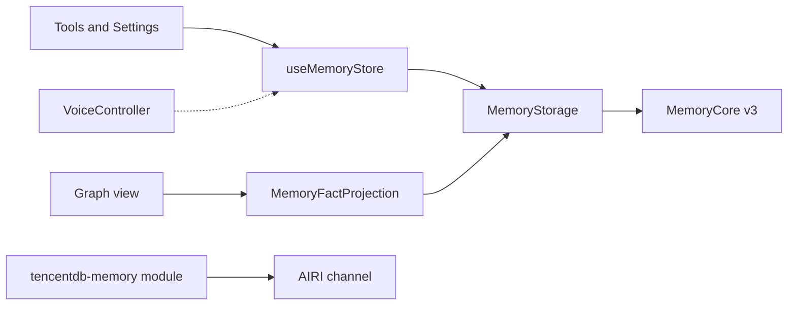

# Memory store, MemoryCore, and the graph view

Status: Accepted for this package boundary. Later stages stay open where this note says so.

This note uses the AIRI types and docs cited below. It also uses the MemoryCore v3 catalog on `feat/server_team` in `TencentCloud/TencentDB-Agent-Memory` (`MemoryCore/v3-api-memorycore-doc.md`). This pull request did not run that gateway. A later pull request that calls a route must read the catalog again.

## Context

AIRI long-term memory is an index plus one fact per entry. `useMemoryStore` in `packages/stage-ui/src/stores/memory.ts` is the writer API. The stored fields today are `id`, `description`, `body`, optional `persona`, and `updatedAt` (`packages/stage-ui/src/types/memory.ts`). IndexedDB holds them (`packages/stage-ui/src/database/repos/memory.repo.ts`). Tools call `builtIn_readMemory`, `builtIn_writeMemory`, and `builtIn_forgetMemory` (`packages/stage-ui/src/tools/memory.ts`). The 2026-10-10 memory note says a fact belongs to one character card, or the owner made it general.

`packages/memory-pgvector` connects to the channel and listens for `module:configure`. It does not store facts. A second writer puts two fact sets in the prompt.

A shared MemoryCore endpoint is one service address. It does not sync Stage Web, Stage Tamagotchi, and later integrations. Auth, stable identity, idempotent retries, concurrent updates, and offline reconciliation are separate later stages.

A graph view and voice or video capture come after this package. This pull request does not implement them.

## Decision

### Ownership and dependency direction

`useMemoryStore` stays the only writer API for tools and Settings. Those callers do not import MemoryCore.

The store calls `MemoryStorage` in `@proj-airi/tencentdb-memory`. That package does not import `stage-ui`. The UI depends on this package. The reverse dependency is not allowed. The live store does not call the device repository. The file `packages/stage-ui/src/database/repos/memory.repo.ts` stays in the repository. A later change can remove it. An offline outbox is still a later stage. It is not a silent read of that file.

`MemoryStorage` is the only write port. Its MemoryCore implementation is the only remote writer. `memory-pgvector` stays unconnected. Do not start it as a memory writer.

The channel module in this package announces `tencentdb-memory` on the AIRI channel. It does not own chat intake. A graph view reads facts. It does not write facts, and it does not write edges into MemoryCore.

The solid arrows are the target direction. The voice arrow is a later hook, not a current import. In this pull request the module only announces, the port is the in-process fake, and startup does not call the gateway.

`core-agent` does not import this package. `VoiceController` already accepts a plugin through `use`. A later voice hook can register there. That does not by itself require an edit to `controller.ts`. This note does not promise that no `core-agent` edit will ever be needed.

### Stage store seam

Delegation landed in `stage-ui`. Tools and Settings call `useMemoryStore`. The store calls `MemoryStorage`. It does not import `memoryRepo`. The device repository file remains, and the live path does not call it.

The tool schema is narrower than a gateway record. `description` is at most 150 characters. `body` is 1 to 2000 characters. A new tool id is null. MemoryCore L0 and L1 content limits in the reviewed catalog are 8192 characters. The adapter must not treat those limits as one number. The model tool also has no session, turn, or asset fields. The host attaches provenance from the run. The model does not.

There is no memory CRUD event in `packages/plugin-protocol/src/types/events.ts`. How the browser reaches MemoryCore is unresolved. The page must not hold the API key. A new channel RPC changes the protocol package. That choice is open.

### One writer

Tools, Settings, and a later voice hook call `useMemoryStore`. The store calls one `MemoryStorage`. That adapter is the only code that writes MemoryCore. The device repository is not a second authority, a cache, or an outbox. An offline outbox is a later stage. It needs its own rule before any code reads the device file again.

`context:update` adds short prompt context. It is not a second fact store. `spark` `memory-recall` is a command kind in `packages/core-agent`. It is not a write to this store.

### Identity and session boundaries

| Id | Where it lives now | Rule |
| --- | --- | --- |
| Team | `resolveMemoryScope` | A private team is `u_<platform>_<userId>`. A group team is `g_<platform>_<groupId>`. A confirmed identity link can replace the private team. |
| User | Real speaker | On this device the speaker is the stable local account id. A group write keeps the speaker id. |
| Agent | Card id, or `airi:general` | Facts and chat use this same id. `agentIdForEntry` maps an empty persona to `airi:general`. |
| Entry | UUIDv7 from the store, or an id the caller already has | Stable fact id. A later retry uses the same id. |
| Session | `ChatSessionMeta.sessionId`, voice `TurnRef.sessionId` | Provenance only. It does not split the card's fact list. |
| Turn | `TurnRef.turnId` | Provenance only. |
| Binding | `InputMessageOverrides.binding` | Provenance for an external scene. The 2026-10-10 note still gives that scene its own chat session. |

The v3 data plane takes `team_id`, `agent_id`, and `user_id` in the body or in `x-tdai-*` headers. This client sends them in the body.

Persona isolation matches the store today: a card reads its facts and the general facts. A private scope and a group scope do not share those facts. The session id does not split one scope's fact list. Cross-group sharing stays off. The resolver accepts a typed hook and does not call it.

### Record, source, and media refs

`MemoryEntry` keeps the stage fields and adds optional `provenance`.

`MemoryProvenance` holds optional `sessionId`, `turnId`, `binding`, `modality`, and `assetRefs`.

`modality` is `text`, `audio`, or `image`. `audio` and `image` match `ChatEventAttachment.type`. That type has no `video` value.

`assetRefs` are `airi-asset:<id>` strings. The prefix is `ASSET_REF_PREFIX`. The protocol text says the id is a SHA-256 of the bytes, and `asset:get:request` answers at most 50 MB. The fact stores the ref. It does not store the bytes. A ref that does not start with `airi-asset:` is rejected. A newer write that omits provenance keeps the stored provenance.

`ContextUpdate` carries `text`, optional `hints`, `strategy` (`replace-self` or `append-self`), and `contextId`. The spark notes say to keep payloads small and to use refs instead of blobs. A later `context:update` from this module stays short text. Asset bytes do not go in that event.

### Graph read model and edges

The reviewed L1 `AtomicDetail` fields are `id`, `version`, `type` (`episodic`, `persona`, or `instruction`), optional `background`, `content`, `created_at`, `updated_at`, and the isolation ids. There is no relation field. `POST /v3/atomic/update` sends `id`, `content`, and optional `background`. This package does not add a relation column.

`/v3/knowledge` type `code-graph` is a knowledge-asset record for MemoryKnowledge. It is not the character graph. This package does not call it.

`MemoryFactProjection.listFacts` is the read port for a later view. It returns facts. It has no edges and no write methods. This pull request exports the type. No view calls it.

`MemoryNotice` is `{ kind: 'stored' | 'recalled', ids }`. `stored` means this process wrote or removed those ids. `recalled` means this process read them for a highlight. The notice has no edges and no media bytes. This package does not emit notices.

The reviewed v3 catalog is POST RPC. `POST /v3/conversation/add` starts an internal `notifyPipeline`. The catalog does not list a client subscription for fact writes. A graph cannot observe MemoryCore writes by listening today. `stored` is therefore visible only after AIRI itself writes, until a later pull request adds a poll or a gateway watch. Whether the gateway will add a watch is unresolved.

A derived line on the view is not an L1 atom and not a stored semantic relation. The view must label it as derived. The view must not write that line back through `atomic/update`.

### Graph page

The whale picture is an approved direction. The mesh stays approximate. Fine shape is a later pass. This page uses `3d-force-graph` as its renderer. A later pull request can tune that scene. It does not replace the renderer.

The layout has four zones, even when a zone has few records. L3 sits in the head. L2 sits on the back. L1 fills the body, off the center line. L0 fills the tail and the fins when higher layers are present. When only L0 facts exist, those facts use the head, the tail, and the fins. One fact stays in the body.

The page is a settings route, on the same pattern as `packages/stage-pages/src/pages/settings/modules/memory-long-term.vue`. It uses `layout: settings`. Web padding and scroll stay in `packages/stage-layouts/src/layouts/settings.vue`. Electron uses `apps/stage-tamagotchi/src/renderer/layouts/settings.vue`. The route is a link from the long-term memory page. The page does not cover the character stage (`DESIGN.md`).

The page reads the live list from `useMemoryStore`. That list is the MemoryCore read for the current team and user. When the service is off, or the read fails, the graph has no nodes and the page shows that status. The page does not read the device repository.

The page also shows the same facts as text. Every drawn line is a derived layout line, and the page says so. The page does not write that line back to MemoryCore. It does not draw a recall pulse. Same-turn recall is a later pass.

L0 facts are the service list. The page also reads `POST /v3/atomic/query`, `POST /v3/scenario/ls`, `POST /v3/scenario/read`, and `POST /v3/core/read` for each fact agent. The legend lists a layer only when that read returns a row. An empty layer is omitted. A failed layer shows the error and no invented rows. The page does not call update, write, or delete on those routes.

L3 is one persona node per character. A markdown heading splits the detail into sections. It does not add a node. L2 is one node per scene file. A directory path is not a node.

L0 and L1 follow the team, the user, and the character. L2 and L3 follow the team and the character only. The gateway scope is `team:<team id>|agent:<agent id>`. A private account and a group each get their own team, so their scenes and persona stay apart. Inside one group team, those layers are shared. The graph shows the current team. The L2 and L3 detail names that team.

Strings go in the English source under `packages/i18n` only. Reduced motion does not start `3d-force-graph`. The fact list stays on the page. Colors for the graph use the theme hue.

### Voice and video lifecycle

`VoiceController` owns admission, `sessionId`, cancel, and interrupt. Plugin work gets an `AbortSignal`. `SpeechInputScope.finalize` runs after transcription and before submit. `FinalizeOptions.timeoutMs` defaults to waiting until the stage ends. A MemoryCore call in `finalize` without a timeout stalls submit. The memory hook must not do that.

The hook runs after the attempt has settled, or after `output:gen-ai:chat:complete`. A cancelled signal writes nothing. Hearing and playback do not wait on the gateway. A failed extract does not change the voice state machine.

A video frame is not a current attachment type. A later frame can use an image `airi-asset:` ref. The capture path is unresolved. It does not add a media socket to this module.

### Endpoint and auth

`TENCENTDB_MEMORY_ENDPOINT` is an `http` or `https` origin. `http://127.0.0.1:8420` is the local gateway. A server origin is valid. The URL must not include a user name, a password, a query, a hash, or a path.

`TENCENTDB_MEMORY_API_KEY` and `TENCENTDB_MEMORY_SERVICE_ID` are required on the wire. A live v3 gateway returns 401 when either header is missing, including when gateway auth is disabled. An empty setting sends the key `local` and the service id `default`. Those are the local gateway values. The client always sends `Authorization: Bearer` and `x-tdai-service-id`. It does not send `x-request-id`. Logs and error text omit the key and the endpoint.

The page calls the gateway from the browser. The gateway must allow the page origin in `server.corsOrigins`. It must allow the headers `Content-Type`, `Authorization`, and `x-tdai-service-id`. A gateway that allows only `Content-Type` and `Authorization` blocks the browser, because this client sends `x-tdai-service-id` on every call.

`timestamp` on `POST /v3/conversation/add` is an ISO-8601 UTC string, such as `2026-11-01T00:00:00Z`. The gateway returns 400 for a number.

The process builds the client only when the endpoint and the three ids are set. It does not call the client during announce. A built client is not proof that the gateway accepts the key.

### Local time rule and later sync stages

Inside one in-process `MemoryRecordMap`, a newer `updatedAt` replaces a row. The same time and the same text are one write. The same time and different text keep the stored row. A removal leaves a tombstone. A newer write of that id restores it. An older write does not mint a second id. `clear` stores a time, and a write at or before that time does not return.

That rule is local to the fake. It is not cross-device sync. It is only a candidate for stage 4 below.

Each stage is its own later pull request. None of them is done here.

1. Auth. A missing or rejected key writes nothing. The test uses a fake gateway.
2. Stable identity. Writers send one team id, one user id, and the card id. The entry id stays the id the store minted.
3. Idempotent retry. The same entry id, `updatedAt`, and text are one remote write. The fake already does this in one process.
4. Concurrent updates. Choose the rule for two different texts before coding it. The local newer-time rule is not that decision.
5. Offline reconciliation. The device keeps an outbox. A retry uses the same id and time. A newer remote row drops the stale item, and the store reads again.

### What this pull request runs

The module connects to `ws://localhost:6121/ws` unless `AIRI_URL` is set. It announces `tencentdb-memory` with an empty `possibleEvents` list. It does not send `input:text`. The v3 client implements `POST /v3/conversation/add` and `POST /v3/conversation/search` only. Tests use a fake WebSocket server and a fake HTTP server.

The graph reads `atomic/query`, `scenario/ls`, `scenario/read`, and `core/read`. It does not call `atomic/update`. The reviewed catalog lists `atomic/update`, `atomic/query`, `atomic/search`, and `atomic/delete` for facts. `atomic/update` returns `version` as a string such as `v2`. Query and search return `version` as a number. The adapter must accept both. If `atomic/update` rejects a new id, store one scenario file per entry at `memories/<id>.json` instead. Both stay inside MemoryCore. That choice waits on a gateway test. It is not decided here.

## Later pull requests

1. After `output:gen-ai:chat:complete`, send one short `context:update` with `replace-self` and a fixed `contextId`. Do not subscribe to `input:text`. Do not put asset bytes in the text. Verify against `ContextUpdate`.
2. Implement `MemoryStorage` on MemoryCore. Confirm insert behavior for `atomic/update`. Store provenance beside the text. Keep asset refs as refs.
3. Point `useMemoryStore` at that port. Edit `stage-ui`, its tests, and the English strings that the switch needs. Leave `memory-pgvector` unconnected.
4. Ship sync stages 1 through 5 in order. Stage 4 starts only after the concurrency rule is chosen.
5. Add the settings graph page. Read `MemoryFactProjection`. Draw derived lines only, with a visible derived label. Keep a text list. Check reduced motion. Do not write edges to MemoryCore.
6. After a settled voice turn, attach provenance and write through the store. Do not call MemoryCore from `finalize` without a timeout, and do not block playback on the gateway.

## Contradictions this note refuses

- A shared endpoint is not working sync.
- The in-process map is not a device replica.
- An empty `possibleEvents` list is not a memory subscription.
- `context:update` and `memory-recall` are not fact writes.
- A derived graph line is not an L1 relation.
- `code-graph` knowledge is not this character graph.
- Types for `MemoryFactProjection` and `MemoryNotice` are not a running view and not an upstream watch.

## Blast radius

| Later change | Packages | Risk |
| --- | --- | --- |
| Fact adapter | `tencentdb-memory` | Gateway field mismatch, especially `version` and insert-on-update |
| Store delegation | `stage-ui`, `stage-pages` | Tool limits, prompt index, IndexedDB tests |
| Channel RPC, if chosen | `plugin-protocol`, `server-runtime` | New event, not required by this note |
| Graph page | `stage-pages`, `stage-layouts`, Electron settings layout, `i18n` | Stage clutter, motion, English source only |
| Voice hook | `stage-ui` plugin registration | Submit stall if `finalize` waits on the gateway |
| `core-agent` controller | None in the plan | Reopen only if the public plugin API cannot express the hook |

`CONTRIBUTING.md` still requires `pnpm lint`, `pnpm typecheck`, and a green unit test before merge. Root `AGENTS.md` still requires kebab-case files, no `any`, and Valibot at the use site. Commits stay conventional. Docs stay in the same pull request. i18n edits stay in the English source. Secrets stay in the environment.

## Validation of this pull request

- Fake storage tests: one shared in-process map, a separate team, the local time rule, provenance, and a rejected asset ref.
- Channel test: a fake WebSocket server, the announce name, and no `input:text` frame. Startup does not call the v3 client.
- Client tests: a fake HTTP server for L0 add, L0 search, headers, and redaction.
- `MemoryFactProjection` and `MemoryNotice` have no runtime test. Nothing emits them.

## Service mode

The live memory path is MemoryCore only. `useMemoryStore` reads and writes that service for the resolved scope. It does not call the device repository. When the service is off, the live list is empty. When the address is missing, the list is empty and the store reports an error. A failed read does the same. The store does not fill the list from device facts.

The settings page can turn the memory service on. When the service is on, the character reads and writes only MemoryCore. Memories that remain only on the device stay out of the prompt and out of Settings.

The page calls MemoryCore over HTTP. The address, the local account id, the service id, and the optional API key are device settings. The private team is derived. The key is not in the source bundle. A later channel RPC can move the key off the page. That move is still open.

A finished chat turn is L0 on the character card, or on `airi:general`. The stage uses `onChatTurnComplete`. It does not listen for `input:text`. A failed or interrupted turn writes nothing. The write is queued, so a gateway error does not block the chat.

Manual facts use that same agent id. They stay in session `airi:facts`. The role is `assistant`. Facts and chat turns both call `appendConversation`. `listFacts` reads that session. The graph draws those facts and reads L1, L2, and L3 for the same agent ids. A character enters that layer list when a manual fact records the card.

This fact role depends on MemoryCore. `handleConversationAdd` notifies L1 extraction only when the batch contains a user message. The source is `feat/server_team` `MemoryCore/src/gateway/v2-router.ts`. That branch has no unit test for the rule. A fact-only batch on the shared agent does not notify. A chat batch on that agent does. If the gateway notifies an assistant-only batch, it extracts stored facts again.

The reviewed catalog has no atomic create route. `POST /v3/atomic/update` returns 404 when the id is new.

`resolveMemoryScope` chooses the team, the user, the agent, and the session for each read and write. The local account id comes from settings, or it is created once and stored. An empty identity map does not merge platform accounts. `confirmIdentityLink` stores a link only when the caller passes confirmation. Old rows under a fixed team id are left in place.

## Unresolved

- Does `atomic/update` insert an unknown id, or only update an existing atom?
- Will a later channel RPC replace the device-local API key, or will the page keep calling MemoryCore?
- Which concurrency rule wins when two devices write different text?
- Do scene-origin facts stay visible on every session of the card?
- Will MemoryCore add a client watch, or must the view poll?
- What is the frame cost of `3d-force-graph` on a large fact list?
- How is a video frame captured, given that chat attachments have no video type?
- What is the whale mesh? Shape direction is approved. The zones are the head, the body, the back, the tail, and the fins. Geometry stays approximate.
- Does standalone MemoryCore enforce team and agent ownership on v3 writes, or does it store any team id the client sends?
- When does same-turn recall highlight a fact without drawing a fake pulse?
