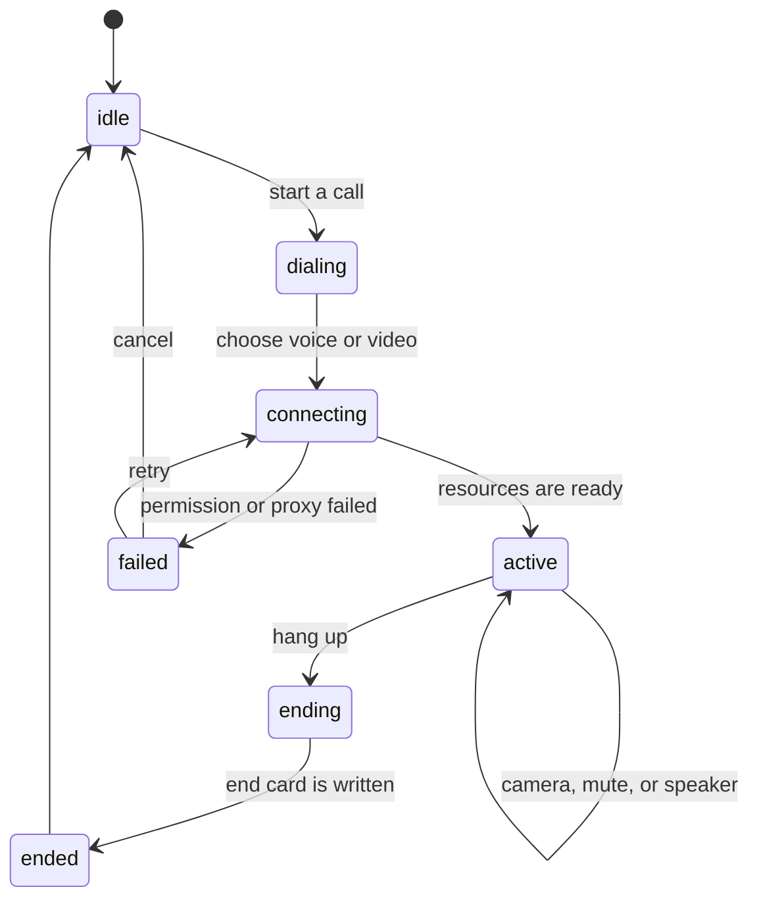

# Voice and video call

Status: accepted. This file is pull request A. Pull requests B through H implement the call.

Depends on [Web voice composer and voice call](./2026-10-29-web-voice-composer-and-call.md) and [Memory store, MemoryCore, and the graph view](./2026-11-05-tencentdb-memory-backend.md).

The memory note is not on `main` yet. It lives on the open memory stack, pull requests [#1](https://github.com/huowa-ai/airi/pull/1) through [#8](https://github.com/huowa-ai/airi/pull/8). This note does not merge that stack.

## Context

The character needs a live call on the current call capsule. The call listens, speaks, and can see. Each turn is stored in MemoryCore. The memory graph can filter that call.

The providers are fixed:

| Role | Choice |
| --- | --- |
| Speech to text | Volcengine Doubao streaming recognition 2.0, model `volc.seedasr.sauc.duration` |
| Speech | Volcengine voice clone 2.0, model `seed-icl-2.0`, speaker `S_hMBcmqRi2` |
| Reply and vision | DeepSeek model `deepseek-flash`, with thinking off |

These gaps are against the code on `main`, plus the memory stack:

1. When `interrupted` is true, `decideChatTurn` skips the whole turn. It cannot store only the text that already played.
2. `server/apps/api/src/services/adapters/tts/volcengine.ts` calls unspeech V1. That path cannot use ICL 2.0. `STREAM_TRANSCRIPTION_EXECUTORS` in `packages/stage-ui/src/stores/modules/hearing.ts` has no Volcengine SAUC executor.
3. `ChatTurnInput` and `onChatTurnComplete` have no `callId` and no `source`. The graph cannot follow one call.
4. Pull request [#7](https://github.com/huowa-ai/airi/pull/7) runs `prepareRecall` from `onBeforeMessageComposed`. Recall waits for the final text. A call is then slow.
5. Barge-in is unstable unless the microphone track forces `echoCancellation`.
6. If a video frame is inside the reply body, `recordChatTurn` writes it to L0. There is no write rule for that frame.
7. `useVoiceCallStore` only starts a call, hangs up, and mutes. It does not run one turn.
8. A Volcengine key in the browser conflicts with the memory note. That note says the page holds no key.

The 2026-10-29 note already owns the call capsule and mute. When the user leaves the stage, that note ends the call. The memory note says a voice hook must not block `finalize`. It also says the page must not hold the key. This note keeps both rules.

## Decision

### Goals

- Reuse `useVoiceCallStore`, `useVoiceStore`, Silero VAD, `VoiceController` barge-in, and the call capsule.
- One path listens, thinks, and speaks. Every turn recalls memory. After hang-up, the same chat shows a call record.
- Video is optional. Each user turn sends one keyframe to DeepSeek. Frames are not stored.
- Typing and the call share one agent and one chat session. Scope uses `resolveMemoryScope` from pull request [#8](https://github.com/huowa-ai/airi/pull/8).

### Non-goals

- Do not use the Volcengine realtime speech model as the reply model.
- Do not use Alibaba Cloud vision as the main vision path.
- Do not add a WebRTC call for several people.
- Do not change the Live2D model.
- Do not merge the stack conflict between pull requests [#7](https://github.com/huowa-ai/airi/pull/7) and [#8](https://github.com/huowa-ai/airi/pull/8). That merge is a separate pull request.

### Path

```mermaid
flowchart LR
  mic[Mic + Silero VAD] --> stt[Server proxy SAUC STT]
  stt --> partial[Partial text]
  partial --> recall[prepareRecall prefetch]
  stt --> final[Final transcript]
  final --> wait[Wait for recall, then filler speech]
  cam[Camera keyframe] --> vision[DeepSeek image]
  wait --> llm[DeepSeek flash stream]
  vision --> llm
  llm --> sent[Sentence split]
  sent --> tts[Server proxy ICL 2.0 TTS]
  tts --> play[Playback and barge-in]
  play --> mem[recordChatTurn L0]
  mem --> graph[Memory graph]
```

The browser talks only to the AIRI server. Volcengine keys and the DeepSeek key stay on the server or in the local environment. They are not in the frontend bundle.

### State machine

The main states are `idle`, `dialing`, `connecting`, `active`, `ending`, and then `ended` or `failed`.



Inside `active`, the substates `listening`, `thinking`, and `speaking` run together. The call can stop playback and still listen. It can synthesize the next sentence during playback of the current sentence.

`mode` sits on `active`. The camera control follows the same rule as WeChat:

| Action | Result |
| --- | --- |
| Choose voice | `mode=voice`. The microphone is on. The camera is off. Speech is on. |
| Choose video | `mode=video`. The microphone is on. The camera is on. Speech is on. |
| Turn the camera off during video | The call becomes voice (`mode=voice`). It does not hang up. |
| Turn the camera on during voice | The call becomes video (`mode=video`). |
| Mute | The microphone track stays open. VAD accepts no input. This keeps the 2026-10-29 mute rule. |
| Turn the speaker off | Speech does not play. The reply still enters the chat bubble. Recognition and recall still run. |
| Hang up | The whole call ends. The camera track and the microphone track are released. |

Turning the camera off does not hang up. Only the hang-up control ends the call.

- `dialing` opens a short menu or a bottom sheet in the chat. The user chooses voice or video. The call has not asked for permission yet.
- `connecting` is the wait before the call is up. The call asks for the microphone. If the mode is video, the call also asks for the camera. It connects the speech proxies, checks DeepSeek, and warms the recall scope. The screen plays the connecting animation from the next section. If that attempt fails, the state becomes `failed`, and the user can retry or cancel.
- On entry to `active`, the chat writes a start record with `callId` and `mode`. Hang-up writes an end record with the duration, the turn count, and the final mode.
- A full-screen call layer covers the stage. When the user leaves the stage route, the call still hangs up, as `useVoiceListening` does today. The call layer itself is not a route change.

### Call screen and connecting animation

The call layer is a temporary cover on the stage. Hang-up removes it. This matches `DESIGN.md`: a control must not cover the character forever. The memory graph stays on the settings layout.

- The character is in the center. In video mode, the user camera is a small window that the user can drag. The call time is at the top. Four controls are at the bottom: microphone, camera, speaker, and hang up.
- The phone button beside the chat input starts `dialing`.
- During `connecting`, the character stays in the center. A ripple or a spinner uses CSS only. The line is "Connecting…". On failure, the line is "The call did not connect." The controls are "Retry" and "Cancel". When the call becomes `active`, a short vibration or a short sound plays.
- During `thinking`, a small cue sits above the character. If recall is slow, the call first speaks the filler "Let me think."
- The user can type during the call. The call layer does not lock the input. The layer can be half height or collapsed. Typed text uses the same session and `source=text`. Recall and the write still run.
- After hang-up, the layer is gone and the same chat session remains. The start card and the end card are visible. A choice of a card filters the graph by that `callId`.

This pull request adds no i18n keys. No component reads a new key yet. An unused key fails `pnpm i18n:check`. When the screen uses the lines, pull request H adds the English source keys. The English lines are "Connecting…", "The call did not connect.", "Retry", "Cancel", "Let me think.", and "I cannot see clearly right now." The call reuses `stage.composer.call`, `stage.call.mute`, `stage.call.unmute`, and `stage.call.hang-up`.

### One turn and the time budget

1. VAD detects speech. Streaming recognition returns text.
2. When the partial text is long enough, `prepareRecall` starts. It uses the current session and the scope from pull request [#8](https://github.com/huowa-ai/airi/pull/8). If that result is stale at the final text, recall runs once more on the final text.
3. If recall is not ready after about 300–500 ms, the call speaks the short filler "Let me think." It does not skip recall. The reply model starts only after recall returns.
4. The final text and the recall block go to `deepseek-flash`. If the mode is video, the call also sends one keyframe. The image detail is `low`. Thinking is off. The reply streams.
5. The call splits the reply into sentences. It synthesizes each sentence, then plays it. During playback, the call synthesizes the next sentence.
6. On barge-in, playback stops. The call cancels unplayed speech and the current reply. Only text that already played is written to memory.
7. The L0 write uses the same `onChatTurnComplete` and `recordChatTurn` path as typing. The write carries `callId` and `source`.

The rough local times to the proxy are these:

- First recognition packet: 200–400 ms.
- Recall, with the prefetch: under 500 ms.
- First model token: 300–800 ms.
- First spoken sentence: 200–400 ms.

The target from the end of user speech to the first sound is under 1.5 s. When the filler plays, that time starts at the filler.

### Memory and the graph

- The call and typing share the current chat `sessionId`. The call does not open a second session.
- The agent id is the character card id, or `airi:general`. Facts stay on `airi:facts`, as in pull request [#6](https://github.com/huowa-ai/airi/pull/6).
- Scope is `resolveMemoryScope` from pull request [#8](https://github.com/huowa-ai/airi/pull/8). A private chat uses `u_*`. A group uses `g_*`.
- Each turn has a `callId` (one UUID for the call) and `source` of `voice`, `video`, or `text`.
- L0 does not keep custom metadata. The write uses the content header in question 1. `ChatTurnInput` and `appendConversation` add the header. The projection removes it before the model and before the bubble.
- `decideChatTurn` changes. If assistant text already played, the turn is written. `interrupted` does not skip that turn. If nothing played, the turn is skipped.
- Recall always runs. The call keeps a ring buffer in `createRecallBuffer` from pull request [#7](https://github.com/huowa-ai/airi/pull/7). The cap stays at 5 items and 800 characters.
- The graph can filter L0 nodes by `callId` and `source`. A call-record message opens the memories for that `callId`.

The memory note left call frames unresolved and allowed a later image `airi-asset:` ref. This note replaces that path for a call. A call frame is not an asset ref.

### Video

- When `mode` is video, the camera opens. When `mode` becomes voice, the camera track stops at once.
- `getUserMedia` shows a local preview in the small window. The user can flip the camera.
- During speech, the sampler takes about one frame each second. During silence, it takes about 0.3 frames each second. Each user turn sends one keyframe to DeepSeek.
- A frame never enters MemoryCore and never enters the asset store.
- The memory text stores only a visual fact that the user showed or asked about, and that a later turn can use. One example is "this is my cat". That fact enters L0 as the turn text, with `source=video`. The call does not narrate every frame.
- If `mode` is still video, sampling can continue with the speaker off. Voice mode takes no frames.

### Secrets

- Volcengine recognition and speech use a server proxy only. Hearing and Speech select an AIRI proxy provider. The page does not hold `X-Api-Key`.
- The DeepSeek key stays in the current server configuration. The browser does not gain a new plaintext key.
- Logs and errors redact tokens and query strings on endpoints.
- Camera permission needs a user gesture, as microphone permission does. Hang-up releases the tracks.

### Module ownership

| Capability | Place |
| --- | --- |
| Thin call UI state (mode, mute, speaker, hang-up) | `packages/stage-ui/src/stores/voice-call.ts` (stays thin) |
| Full-screen layer, dialing menu, connecting animation, four controls | A new call component in `packages/stage-ui` (CSS animation, no new dependency) |
| Call state machine, filler, sentence speech, video gate | New `packages/stage-ui/src/stores/call-orchestrator.ts`, or `composables/call/` |
| Microphone, VAD, barge-in, playback | Current `stores/voice.ts`, `composables/audio/voice-controller`, and `pipelines-audio` |
| Volcengine SAUC recognition proxy | A new adapter in `server/apps/api`. Register it in `STREAM_TRANSCRIPTION_EXECUTORS`. Reuse `createTranscriber`. |
| Volcengine ICL 2.0 speech proxy | A new adapter under `server/apps/api/.../tts/`. It does not use unspeech V1. Stage speech uses that proxy. |
| Chat hooks and call-record messages | `stores/chat.ts` (`onBeforeMessageComposed` and `onChatTurnComplete`) |
| Interrupted-turn write rule | `packages/tencentdb-memory/src/chat-turn.ts` |
| Recall prefetch and the ring buffer | `tencentdb-memory` recall and `stores/memory.ts` |
| Scope | `tencentdb-memory/src/memory-scope.ts` |
| Graph filter | `stage-pages/.../memory-graph*.ts` |
| This note | `docs/ai/adr/2026-11-06-voice-video-call.md` |

`tencentdb-memory` does not depend on `stage-ui`. If the current plugin hooks can run the call, `core-agent` stays unchanged. The orchestrator uses those hooks.

### Pull request split

Each pull request can merge alone and can be checked live. None of them pushes to `main`.

| Pull request | Content | Live check |
| --- | --- | --- |
| A | This note. If lint requires keys, add the English source keys. | Document review and `pnpm lint` |
| B | Change `decideChatTurn` so an interrupted turn stores played text. Add a unit test. | A simulated interrupt writes one cut assistant message on a fake gateway. |
| C | Server proxies for Volcengine recognition and speech, plus Hearing and Speech provider registration. | One cloned sentence is recognized or spoken with no key in the browser. A capture shows no `X-Api-Key` from the page. |
| D | `callId` and `source` on the write path, plus a graph filter. | One typed turn has `source=text`. The graph can filter it. |
| E | Orchestrator: main state, mode, partial-text recall, filler, sentence speech, forced echo cancellation, and barge-in. | A real call recalls a spoken name on the next sentence. Slow recall plays the filler. An interrupt keeps only played text. Camera off becomes voice and does not hang up. |
| F | Video keyframe and the visual memory rule. | One object question sends one frame. MemoryCore has no image bytes. A useful description has `source=video`. |
| G | Start and end cards in the chat. | After hang-up, the same session shows the cards. A choice filters that `callId`. |
| H | Full-screen layer, dialing, connecting and failure animation, four controls, and i18n. | The phone control shows the wait animation, then the call. Camera off becomes voice. Hang-up returns to the chat. |

The order is A, then B, then C, then D, then E, then H, then F, then G. E depends on C and B. H can run beside E with a mock orchestrator. F depends on E. G depends on D and E.

## Consequences

- A call turn always waits for recall. The filler covers a slow recall. The reply model does not start early.
- An interrupt stores played assistant text, including a played filler. The old skip of every interrupted turn ends.
- Call tags live in the message content. They do not live in gateway metadata.
- Video frames are not memory and are not assets. Only useful visual facts become text.
- The page still holds no provider key. A new browser key breaks the memory note.
- The full-screen layer is temporary. Hang-up removes it. When the user leaves the stage route, the layer is removed too.
- This repository does not keep probe logs beside ADR files. The probe result is question 1. The probe log is not committed.

## Decisions already made

- The camera control follows WeChat. Camera off becomes voice and does not hang up. Hang-up is its own control.
- The call has a full-screen layer and a CSS connecting animation.
- Every call recalls memory. A slow recall plays the filler. Recall is not skipped.
- The call and typing share one chat session. Frames are not stored.
- The user can type during the call, in that same session.
- If vision fails, the call says "I cannot see clearly right now." and continues as voice.
- A filler that already played counts as played memory. A dropped network retries the proxy once. Electron and the web use one proxy entry.

## Questions

1. Does L0 keep custom metadata? No.

   A live local MemoryCore gateway was probed on 2026-11-06. The OpenAPI item schema has `role`, `content`, and `timestamp` only. `id` is read-only. The message and the add body have no `metadata`, no `callId`, and no `source`.

   The probe sent message-level `metadata`. It also sent message-level `callId` and `source`. It also sent those fields at the top level. Each request was accepted with HTTP 200. `query` and `search` then returned none of those fields. The gateway drops them with no error.

   A content header comment stayed inside `content`. The probe rows were removed with an exact delete. The deleted count matched.

   Pull request D writes this header, then a newline, then the body:

   `<!-- airi:meta callId=<uuid> source=voice|video|text -->`

   `ChatTurnInput` and `appendConversation` add the header. The projection strips the header before the model and before the bubble. Recall display strips it too. Pull request D does not rely on gateway metadata.

2. Does a played filler count as played memory after an interrupt? Yes. The source is `voice`.
3. Do Electron and the web use one proxy entry? Yes.
4. Do the call pull requests stack after [#7](https://github.com/huowa-ai/airi/pull/7) and [#8](https://github.com/huowa-ai/airi/pull/8) merge? That merge still needs an explicit yes. Until then, this note stays a docs-only pull request on `main`.
5. What does the call do after a DeepSeek vision failure? The call says "I cannot see clearly right now." Then it continues as voice. The failure is logged. The next turn can try vision again.
6. Can the user type during a call? Yes. The call layer does not lock the input. Text and speech use one `sessionId`, the same recall, and the same write. Typed text has `source=text`. A text reply enters the bubble. If the speaker is on, that reply can also be spoken, with the same barge-in rules.
7. What does the call do after the network drops? The proxy retries once. If that retry fails, the call shows "The call did not connect." The user can hang up or retry.

## Alignment

- `.github/CONTRIBUTING.md` requires `pnpm lint` and `pnpm typecheck` before a commit, and the same unit tests as CI. Do not push this work to `main`. This pull request changes no runtime code, so the lint run is the check that applies.
- The [airi-docs contributing guide](https://github.com/moeru-ai/airi-docs/blob/main/content/en/docs/contributing/index.md) uses the same branch, lint, and pull request path.
- Root `AGENTS.md` requires kebab-case file names, no `any`, shared logic in `packages/`, docs in the same pull request, and an English i18n source.
- `packages/i18n/AGENTS.md` says new copy goes only into the English source, then `pnpm i18n:check`. This pull request adds no keys.
- `DESIGN.md` says the stage stays the character's space. The call layer is temporary. The graph stays on the settings layout.
- The airi-docs character-card docs keep the agent id as the character card id. This note does the same. If there is no card, the agent id is `airi:general`.
- The 2026-10-29 note owns the call capsule and mute.
- The 2026-11-05 memory note owns MemoryCore. That note says the page holds no key. It also says a voice hook does not block `finalize`.
