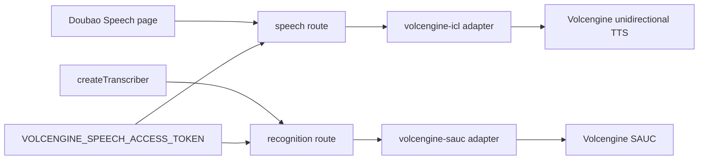
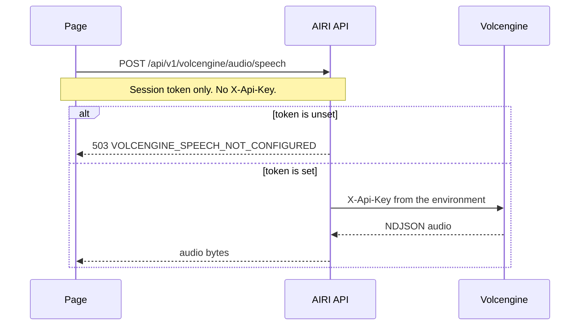

# Doubao speech proxy

Status: accepted

This note implements pull request C from [Voice and video call](../../../../docs/ai/adr/2026-11-06-voice-video-call.md). That note is on `main`. This branch does not merge it.

## Decision

AIRI proxies Doubao voice clone 2.0 and Doubao streaming recognition 2.0. The browser talks only to AIRI. `X-Api-Key` stays in `VOLCENGINE_SPEECH_ACCESS_TOKEN` on the server.

Speech uses `POST https://openspeech.bytedance.com/api/v3/tts/unidirectional`. The resource is `seed-icl-2.0`. The default speaker is `S_hMBcmqRi2`. This path does not send an app id. It does not use the unspeech V1 adapter in `volcengine.ts`. That adapter cannot select ICL 2.0.

Recognition uses `wss://openspeech.bytedance.com/api/v3/sauc/bigmodel`. The resource is `volc.seedasr.sauc.duration`. The browser uploads PCM and reads transcript snapshots. Hearing registers `volcengine-doubao-transcription` in `STREAM_TRANSCRIPTION_EXECUTORS` and reuses `createTranscriber`.

An unset token does not remove the routes. The request returns 503 `VOLCENGINE_SPEECH_NOT_CONFIGURED`.

## Scope

- The speech route `POST /api/v1/volcengine/audio/speech`.
- The recognition route `POST /api/v1/volcengine/audio/transcriptions/stream`.
- The Doubao Speech and Doubao Hearing providers. Their configuration has no API key.

Non-goals:

- The call screen, the orchestrator, video, and `callId` metadata.
- Flux billing for this proxy. The route checks the session only.
- A change to the existing Volcengine V1 provider. That provider still uses unspeech.

## Module dependencies



## Affected files

```text
server/apps/api/src/
  libs/env.ts
  app.ts
  routes/volcengine-speech/route.ts
  services/adapters/tts/volcengine-icl.ts
  services/adapters/stt/volcengine-sauc.ts
packages/stage-ui/src/
  libs/providers/providers/volcengine-doubao/
  stores/modules/hearing.ts
packages/stage-pages/src/pages/settings/providers/
  speech/volcengine-doubao-speech.vue
  transcription/volcengine-doubao-transcription.vue
packages/i18n/src/locales/en/settings.yaml
server/docs/ai/adr/2026-11-06-volcengine-speech-proxy.md
```

## Sequence



Recognition follows the same auth rule. The API opens the SAUC socket and returns `transcript.text.snapshot` events.

## Test plan

- Adapter tests mock the speech endpoint and a local SAUC socket. The upstream header is the server token. A client `X-Api-Key` does not replace it.
- Route tests cover 401, 503, and one proxied success for speech and recognition.
- The provider test checks that the configuration and the outbound fetch omit `X-Api-Key`. The request URL is the AIRI path.
- Run the API typecheck and the API tests for these files. Run the stage-ui typecheck and the provider tests. Run `pnpm i18n:check` and `pnpm lint`.

Live check, with a token that is not in git:

1. Put `VOLCENGINE_SPEECH_ACCESS_TOKEN` in `server/apps/api/.env.local`.
2. Start the API.
3. Sign in. Open Doubao Speech. Play one sentence.
4. Make sure that the page request has no `X-Api-Key` header.
